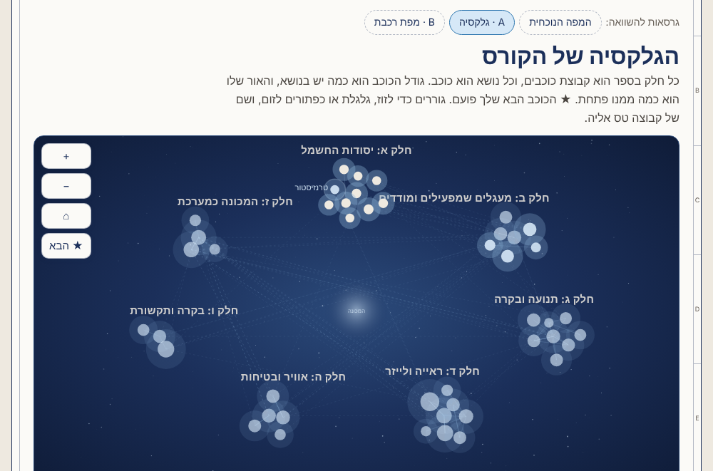
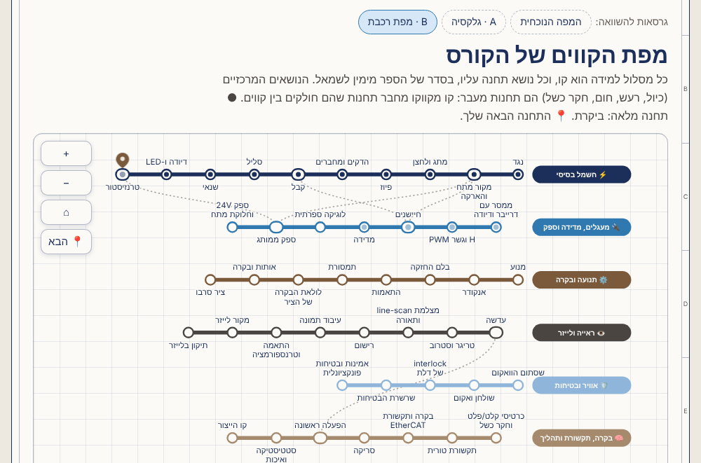

# Ideas we may come back to

Views that were built, tested and then set aside. Each one is still whole in the tag where it last shipped, so it can be brought back as it was.

## The world map as a galaxy, and as a metro map (v2.72.0)

Two versions of the world map, built side by side so they could be compared. The second-brain graph (v2.73.0) replaced both, and the 3D world map with them.




| | A · galaxy | B · metro map |
|---|---|---|
| Groups | the parts of the book, as constellations around the machine | the six learning tracks, as lines |
| A topic is | a star: its size is how much there is in it, its light how much of it was opened | a station, in the book's order from right to left |
| Links | every link between topics; solid inside a part, dashed across parts | only the central subjects, as interchanges between lines |
| Next topic | a pulsing ring | a pin |
| Good for | a first look at the whole course and where you have been | knowing exactly where you are on a track and what comes next |

**Why they might come back.** The metro map answers "where am I on my track" better than any other view, and could return inside the learning path. The galaxy is a good picture of the book's parts for a cover page or a video.

**To bring them back:** the code is `src/92b-maps.js` at tag `v2.72.0` (two hidden zoom views, `galaxy` and `metro`, with their own pan and zoom, `mapsPanZoom`), its CSS is the block marked "v2.72: the two map versions" in `src/00-shell.html` at the same tag, and its tests are `tests/maps_audit.mjs` (suite `maps`, 55 checks).

```
git show v2.72.0:src/92b-maps.js > src/92b-maps.js
git show v2.72.0:tests/maps_audit.mjs > tests/maps_audit.mjs
```

## The 3D world map with storeys (v2.44.0 to v2.72.0)

Every topic was a point in space and height was its scale: the process at the top, components at the bottom, each storey a ring. It showed the cone the book is built on. The second-brain graph keeps the space and the turning, and lets the links decide where a topic stands instead of its scale. The storeys and the layout (`zWorldLayout`, `ZW`) are in `src/92-world3d.js` at tag `v2.72.0`.

## The zoom levels as layers in 3D (v2.23.0 to v2.72.0)

The five zoom levels as planes stacked in space, with the core chain as an axis through them, drawn on a canvas. It said the same thing as the topic tree and the old world map. `z3dView` and its state `Z3` are in `src/78-zoom-views.js` at tag `v2.72.0`.

## Found by the graph: two topics with no link

Drawn as a second brain, two topics stand alone: digital logic (`logic`) and statistics and quality (`stat`). Nothing in the data says what they are made of, what they work with, or where a fault there leads. The graph keeps them beside their part of the book, but the links themselves are worth writing. A likely start: digital logic under the I/O cards and serial communication, and statistics under the scan and the production line.
