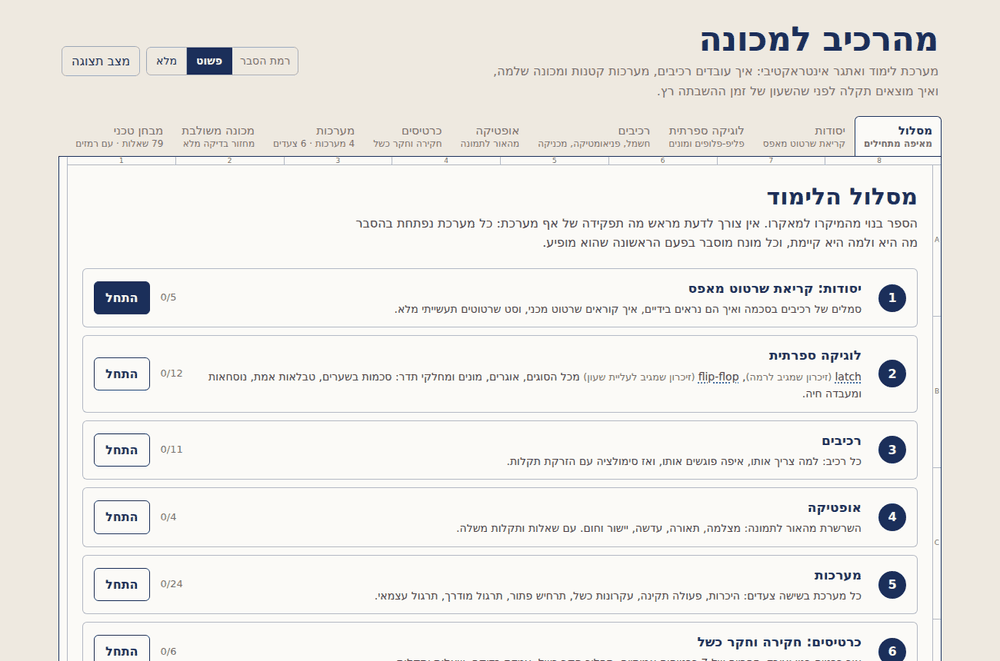
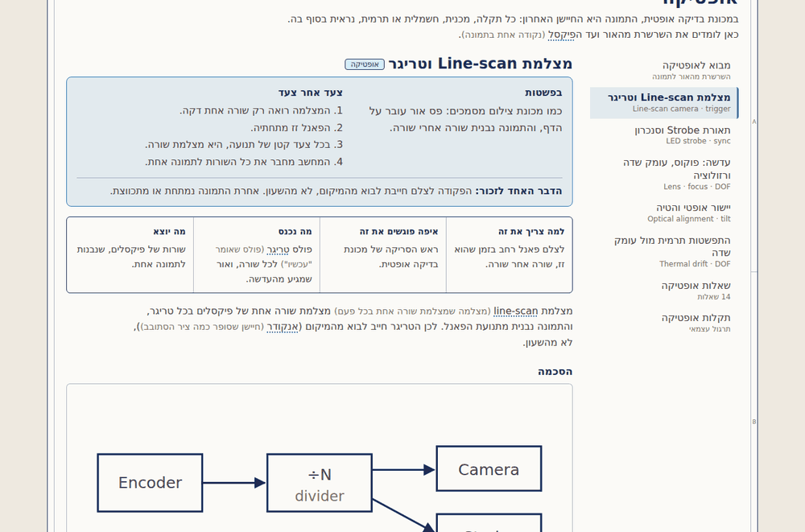
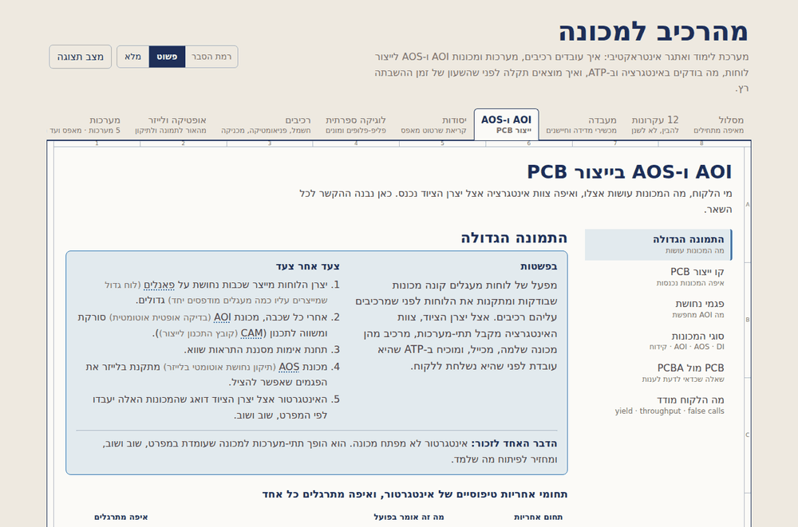
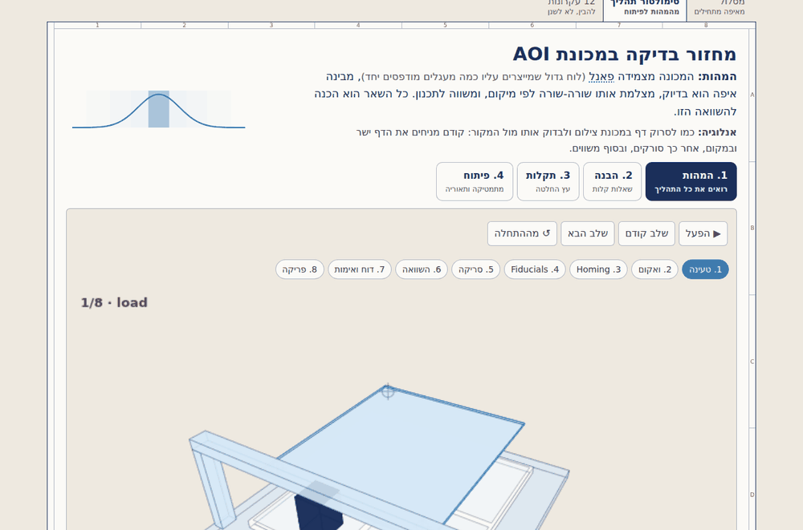
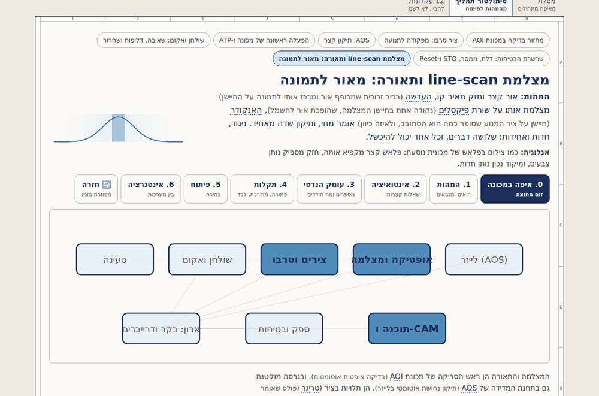
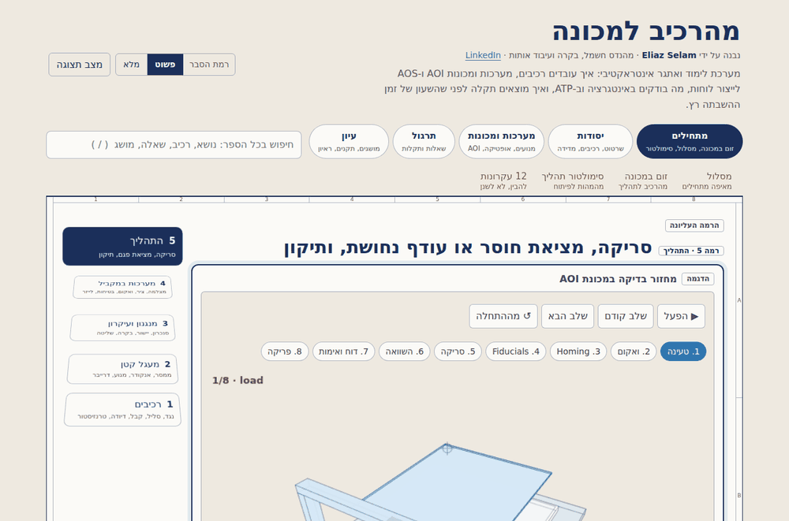
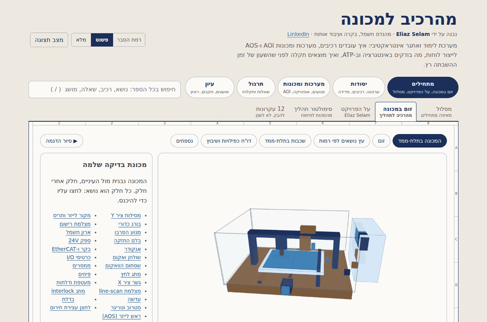
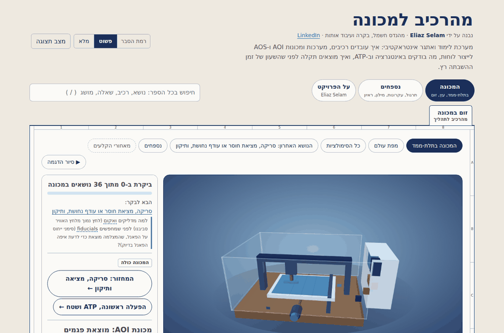
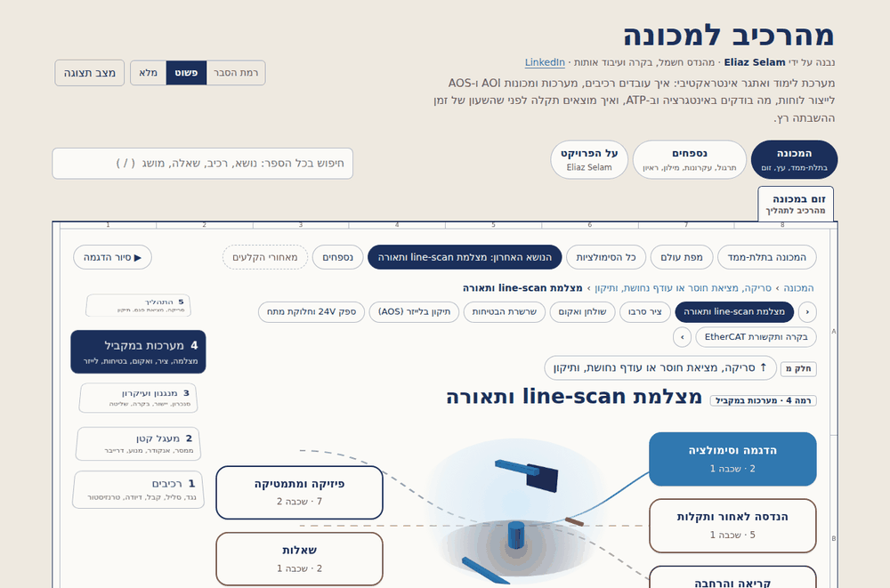

# From the first version to today: milestones

Each picture is a screenshot of that version's own shipped file (`index.html` at the tag), opened on the page that shows what the version added. Every tag in this repository is a milestone you can check out and open.

| Version | Date | What it was | Size |
|---|---|---|---|
| [v1.0.0](#v100) | 18 Oct 2026 | First public version: a book of pages by type | 0.66 MB |
| [v1.2.0](#v120) | 21 Oct 2026 | A second live figure: why the trigger comes from the encoder | 0.93 MB |
| [v2.0.0](#v200) | 29 Oct 2026 | AOI and AOS enter: from-zero lessons, a lab, a repair laser | 1.33 MB |
| [v2.9.0](#v290) | 6 Nov 2026 | The process simulator: every topic opens from the essence outward | 1.62 MB |
| [v2.14.0](#v2140) | 7 Nov 2026 | A topic in full: the line-scan camera, from photon to image | 1.76 MB |
| [v2.22.0](#v2220) | 10 Nov 2026 | The zoom: five scales, each made of the one below | 1.86 MB |
| [v2.25.0](#v2250) | 10 Nov 2026 | The machine in 3D, assembling itself | 1.92 MB |
| [v2.36.0](#v2360) | 12 Nov 2026 | A topic as an object, seven levels, a graph of topics, two machines | 2.05 MB |

## v1.0.0

**The idea:** a learning book. Learning path, foundations, digital logic, components, optics, boards, systems, an integrated machine, a technical test, a fault challenge, standards and interview preparation. 79 questions, 37 faults, 225 glossary entries, and an automatic self-check from the first day.

## v1.2.0

**What changed:** figures that answer back. A line-scan camera on a conveyor: switch the trigger between the encoder and a clock, change the belt speed, and watch the captured image stay round or stretch.

## v2.0.0

**What changed:** the book reaches real machines. AOI and AOS for PCB manufacturing, a from-zero layer of 24 lessons and 157 terms, a lab (multimeter, generator and oscilloscope, sensors), the integration process, an AOS machine in six steps, a repair-laser simulation and fiducial registration.

## v2.9.0

**What changed:** the first time a topic is a process and not a page. Every topic opens like a Gaussian, from the essence outward: an end-to-end 3D simulation first, then questions, then faults as decision trees.

## v2.14.0

**What changed:** the pattern is proven on a full topic. The line-scan camera and its lighting in eight steps, with predictions, a model checked against every fault, and derivations.

## v2.22.0

**What changed:** structure replaces tabs. Five scales, from a component to the whole process, each made of the one below ("Powers of Ten"); every window has exactly one home, and a test fails if the same content appears twice.

## v2.25.0

**What changed:** the machine itself is the way in. One complete inspection machine in 3D that assembles part by part, comes apart, and opens down to the component; simulations first, theory after.

## v2.36.0

**What changed:** the machine and the line (AOI, verification, AOS) as separate machines; each topic as an object with seven numbered levels of depth around it; a graph of all topics with the scales as rings; fourteen animated derivations; and an automatic check that no simulation was lost along the way.

## From the first version to now, in numbers

| | v1.0.0 | v2.36.0 |
|---|---|---|
| Questions | 79 | 112 |
| Faults | 37 | 48 |
| Glossary entries | 225 | 616 |
| Animated derivations | 0 | 14 |
| Windows, each with exactly one home | none | 458 |
| Ways in | pages by type | the machine in 3D, a graph of topics, a path |
| Automatic checks | a self-check (numbers, logic, page crawl) | 11 suites; the zoom suite alone runs about 47,000 checks |
| File | 0.66 MB | 2.05 MB, one file, no server |
